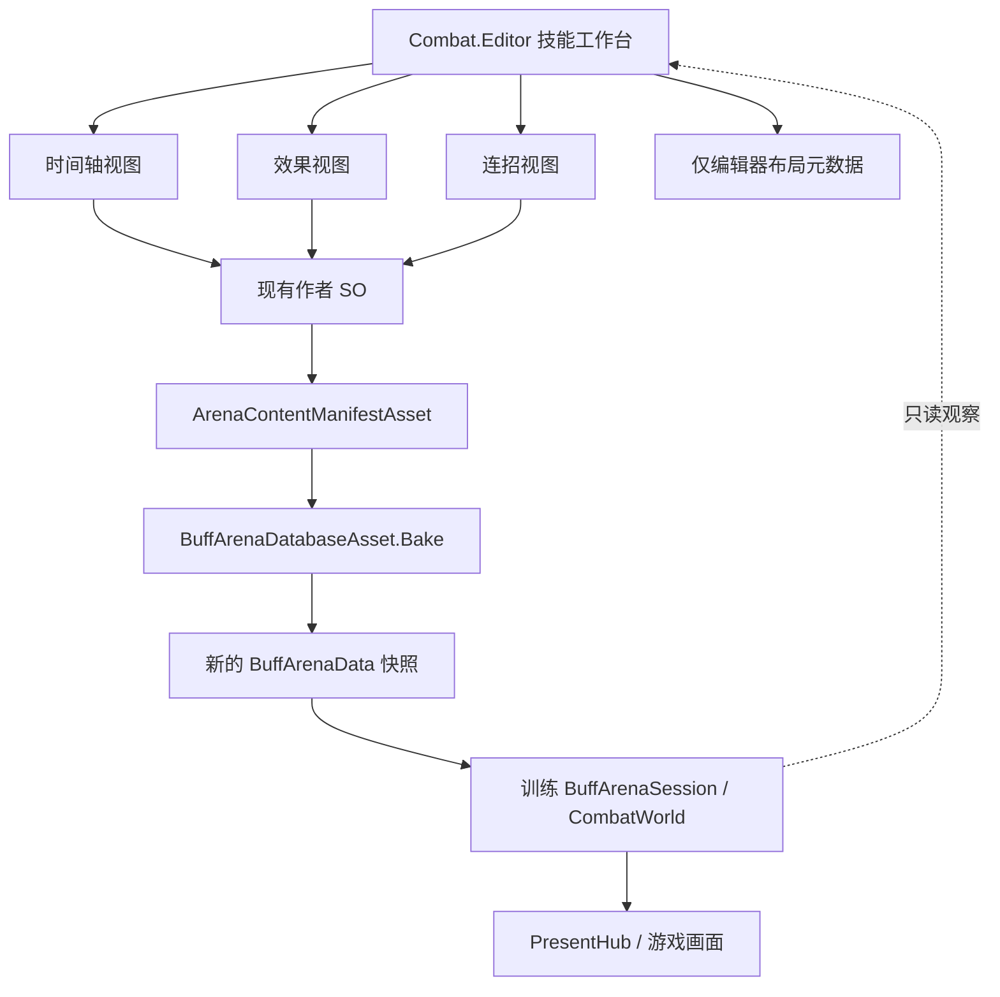
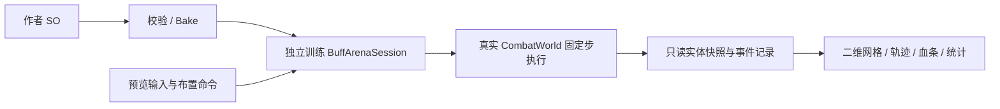

# HaloCombat 技能工作台设计方案

> 2026-11-14：本方案已被用户新的决策取代。当前目标为按参考视频复刻独立网页技能编辑器，以 JSON 为唯一战斗配置源，并移除 SO 内容加载路径。实施范围以 [网页技能编辑器功能清单](网页技能编辑器功能清单.md) 与 [ADR-0001](adr/0001-web-skill-editor-json.md) 为准。下文保留为历史设计记录，其中 Unity Editor 主工具、SO 唯一来源和依赖 SO Bake 的方案不再执行。

状态：提案，尚未实现或形成已接受的 ADR。调研日期：2026-11-13。

目标：让内容作者能够在一个窗口内理解、修改和验证当前项目的技能；学习参考视频的节点组织、局部预览和快速试验流程，将现有战斗能力准确呈现在编辑器中。

本轮完成了视频完整音轨的本地转写、全片每 8 秒的画面检查，并对两处转写不清的区间重新识别。视频演示可以支持下面的产品分析，但没有提供作者的工具源码、完整 JSON 协议或内部实现，不能据此证明其运行架构。

**推荐决策：首版采用 Unity Editor 技能工作台，保留 SO 为唯一内容源，以时间轴、效果图、连招图三个协同视图编辑现有模型。** 完整后台与新增战斗机制分别验收。交互示意只说明操作方式，不代表已接入 Unity。

## 参考视频的完整功能脉络

参考对象：B 站 BV1cC4J6fEac，《我做了一个最适合新手设计技能的后台》，时长约 10 分 55 秒。下列时间为定位区间，个别操作跨区间连续发生。

| 视频区间 | 演示内容 | 对本项目的启发 |
| --- | --- | --- |
| 00:00–01:08 | 介绍节点式技能导表工具；普通射击由目标选择、施放限制、效果传递、效果结算组成；可配置消耗、冷却和投射物 | 用领域操作组织界面，直接显示技能的执行关系 |
| 01:08–01:58 | 命中点爆炸，扩大伤害半径，发送配置并回到游戏按 F7 测试 | 区分弹体本身的碰撞半径与命中后爆炸的作用范围 |
| 01:58–02:30 | 为投射物配置穿透，实测穿过多个敌人 | 把投射物行为与最终伤害配置分开 |
| 02:30–03:33 | 连锁射击；设置跳转次数、搜索半径，以及最近或随机的下一目标选择 | 搜索规则、次数和重复命中规则都应可见，不能只画一条“连锁”线 |
| 03:33–04:09 | 命中后分裂出多枚子弹，调整数量、飞行速度与距离 | 分裂的生成位置是命中点，事件上下文必须准确 |
| 04:09–04:50 | 类似女枪大招的扇形弹幕；按住引导，或改成有限次数的瞬发连射；作者也提到 Buff、Debuff 和地面持续伤害 | 将持续施放、有限连发、弹道形状、Buff 生命周期分开建模；提到的能力不等于逐一完整演示 |
| 04:50–07:16 | 从新建开始制作“死亡射击”：随机方向、20 发有限连发、缩短间隔，再改成持续引导；实测边走边射，并提高弹速 | 模板、新建、节点内参数、即时示意与真实游戏验证构成工作闭环 |
| 07:16–07:56 | 展示 JSON；说明其他引擎需要适配层与预先实现的技能模块 | JSON 负责描述参数；执行能力来自引擎中的对应模块。视频没有展示跨引擎接入的验证 |
| 07:56–09:24 | 新建闪现打击；随机范围内选敌，比较冲刺与精确闪现，缩短冷却；过程中也出现新建后未立即显示的情况 | 选择目标、移动方式、伤害时机和编辑器错误反馈应分明 |
| 09:24–10:26 | 演示近战刺击、扇形与 360° 旋风斩的参数调整，切换目标位置/方向选择 | 形状与方向需有空间预览；不能用圆形判定冒充扇形 |
| 10:26–10:55 | 总结，邀请描述其他技能以补全模块，表示完善后再提供使用 | “几乎所有技能”是作者的目标和描述，不能作为已验证的能力清单 |

视频的价值在于：少量高层节点能够解释技能，参数围绕节点展开，左侧简化空间演示帮助理解，最后能将配置交给游戏验证。我们应保留这些体验，同时准确表达 HaloCombat 已有的 Timeline 和事件生命周期。

## 已核对的项目基础

以下为本轮源码检查结果，不是旧文档或历史测试结果。

| 职责 | 当前实现与依据 | 对工作台的约束 |
| --- | --- | --- |
| 内容入口 | `BuffArenaDatabaseAsset.Bake()`；`ArenaContentManifestAsset` 维护强类型引用 | 工作台先选择数据库与 Manifest，新增内容同时加入该 Manifest |
| 技能定义 | `BuffArenaSkillAsset` 保存 Timeline、AmmoCost、缺弹回退与追踪弹分支 | 优先展示这些实际生效的字段；技能不承担输入映射 |
| 技能时间 | `SkillTimelineAsset`；内联 `TimelineClipAsset[]`、`TimelinePayloadAsset[]` | 时间轴必须是一等编辑视图 |
| 持续区间 | `ClipKind.CancelTag / Move / Hitbox / IFrame` 与各 handler | 持续行为有开始、区间 Tick 和结束清理，不能当成一次性 Effect |
| 离散执行 | `TimelinePlayer.FirePayloads()` 进入 `World.Deliver()` | Payload 只触发一次；同一步到期项与每个效果包均保留原数组顺序 |
| 命中效果 | `ProjectileDefAsset`、`AoeDefAsset`、`DurationSpecAsset` 的事件数组 | 以事件端口组织效果，区分触发顺序和资产引用 |
| 结算 | `EffectPipeline.Run()` 按顺序执行；`AfterDamageEffect` 条件执行后续效果 | 不引入图解释器，也不把普通连线画成新的短路/成功分支协议 |
| 玩家连招 | `ComboTableAsset` → `ComboComp` → `BuffArenaPlayerComp` → `SkillDirectorComp` | 连招图编辑边表，不创建新的阶段状态 |
| 输入 | `BuffArenaSession.ApplyInput()` 的代码映射；ComboEntry 的 `InputAction` | 界面从已有 token 选择，显示真实按键提示，不在技能中重复配置 |
| 试验场 | `BuffArenaBootstrap.TrainingDummy`、`BuffArenaSession` 木桩模式 | 可复用现有训练入口，仍需验证其编辑器接入流程 |
| 重开 | `BuffArenaBootstrap.RestartRun()` 释放旧会话并重载场景 | 首版采用保存后重新 Bake、重建试验场的方式生效 |

当前版本为 Unity `6000.0.32f1`。已有 `Combat.Editor` 引用 Core、Config、Unity；已有 UI Toolkit 引擎模块、Timeline 与 Visual Scripting 包。当前编辑工具主要是 `TimelineClipAssetDrawer`，没有发现现成技能图编辑器。



**不能忽略的能力差异：**

- Core 的 `SkillDefinition.Cooldown` 与 `SkillDirectorComp.Play(skill)` 有冷却路径，但 Arena 的 `BuffArenaSkill` 没有冷却字段；工厂未安装该 SkillCatalog，玩家调用的是 `Play(skill, timeline)`。后台的冷却输入必须在接通此路径后才能启用。
- 现有弹体支持 Linear、ImmediateHoming、Accelerate、ReturnToOwner、Bounce；穿透可通过命中次数等规则表达。未发现视频那样通用的命中连锁、命中分裂或扇形散射配置。
- `SpawnProjectileEffect` 当前从施法者位置与朝向发射。把它简单接到 OnHit 后，不能据此宣称会从命中点向外分裂。
- 现有 AoE 与 Hitbox 的主要范围参数是半径及偏移，未发现视频那样的通用扇形/刺击形状参数。
- 普攻有 Held 连射；它与视频中“任意技能按住引导、松开结束”的能力不同。有限次数发射可以使用多个 Payload，持续引导需要明确运行时语义。
- 传送弹依赖 `ProjectileTrackerComp / TryTeleport()`；木桶连锁依赖 `BarrelExplosionEffect` 等产品代码。它们可以作为具名领域节点展示，不能包装成已经存在的通用目标选择或连锁节点。
- Core/Config 中有召唤相关类型，但当前 Arena 的 `WorldInstall.Summons` 是空目录，Manifest 也没有召唤清单。首版不把“可在 Arena 召唤”列入已支持能力。

## 工作台的操作方式

建议菜单：`Tools/HaloCombat/Skill Workbench`。一个窗口包含资源导航、中心编辑区、所选节点属性、试验与诊断区。

资源导航以当前 Manifest 为边界，提供技能、Timeline、投射物、AoE、Buff、连招和 Cue 的检索及引用定位。默认按显示名检索，运行时 ID 由工具分配并在高级信息中展示；作者选择资产引用，不手填跨资产 ID。

中心编辑区有三个协同视图。选中同一项时，属性、引用关系和诊断位置同步；三个视图直接维护相同的作者资产。

**时间轴视图负责“何时发生、持续多久”。**

- 编辑总时长、AnimatorState、ControlTags 和动作速度缩放。
- 四条 Clip 轨道分别表示取消窗、位移、判定和无敌；离散 Payload 用时间点表示。
- 拖动 Clip 的左右端修改 Start/End，拖动 Payload 修改 Time。可吸附到 50 Hz 的 0.02 秒网格，但不强迫所有资产改成整数帧。
- 同时显示秒与逻辑步提示。标签明确说明角色局部顿帧和动作速度缩放会影响实际推进；时间位置不能被误解为固定墙钟时刻。
- 选中 Payload 展开效果链，选中 Hitbox 展开 HitProfile。Clip 不提供任意 Effects 输入口。
- 显式显示数组顺序；图中卡片位置、自动排版和按时间展示均不隐式重排数组。多个事件落在同一逻辑步时，以运行时实际顺序为准。
- 编辑器拖动游标只做静态几何/时序显示；需要查看某时刻的真实世界状态时，从初始种子重建并前进模拟，不倒写运行态。

**效果图负责“生成什么、哪个事件触发什么”。**

以已有资产生成投影，卡片对应 Skill、Timeline、Payload、Effect、Projectile、AoE、Buff、HitProfile 和 Cue 引用。连接有明确类型与字段含义：资产引用、事件效果列表、列表中的顺序；图中不提供任意通用执行流连线。

例如现有基础射击可以展开为：

```text
SK_2001 → TL_3001
             ├─ Payload 0.10s → [0] PlayCue 4201 → [1] SpawnProjectile
             │                                        └─ PD_4001
             │                                            └─ OnHit
             │                                                → Damage
             │                                                → HurtFeedback
             │                                                → 命中 Cue
             │                                                → ApplyDuration
             └─ CancelTag [0.50s, 0.80s)
```

对应事件端口完整覆盖：

| 类型 | 事件端口 |
| --- | --- |
| Projectile | OnHit、OnExpire、OnObstacle、OnOwnerHit |
| AoE | OnPulse、OnEnter、OnExit、OnStay、OnExpire |
| Buff | OnApply、OnStack、OnPeriod、OnExpire、OnHurted、OnOwnerCast |
| Hitbox / HitProfile | 命中效果包及其真实烘焙顺序 |
| AfterDamage | 实际扣血、阵营和施法资格条件通过后的效果包 |

每个事件入口显示当前可用的 Source、Target、Point 及含义。例如玩家 Timeline 的普通 Payload 没有行为树选中的 Target，自增益应选择 Self；OnHit 才有受击目标；OnExpire 不能凭空获得一个受击者。首版提示或阻止明显不成立的配置，不提供尚不存在的通用选敌节点。

`HitProfileAsset.Bake()` 当前先执行自定义 `Effects[]`，再追加 Damage、Stun、Knockback、Launch、IFrame。工作台必须照实显示，不能为了统一外观把所有项自由拖动为另一种顺序。普通 `EffectPipeline` 也没有统一“失败后停止后续节点”的语义；AfterDamage 条件不成立只跳过自身内部包。

同一 Effect 资产在多个事件中出现时，每个使用位置显示为独立的引用卡片，参数仍指向同一资产；重复引用同一 Effect 两次依然表示执行两次。不能为了图去重而改变效果包。

**连招视图负责“哪个输入在什么资格下接到哪个技能”。**

- 节点是 Skill；条件卡片是实际的 `ComboEntryAsset`。空前置画为起手入口。
- 一条 Entry 的多个 PreSkills 是任一来源匹配，RequiredTags 是全部满足；保留同一条 Entry，不静默拆成多条不同语义的记录。
- 条件卡编辑 InputAction、RequiredTags、Priority、目标 Skill；目标 Timeline 从 Skill 引用派生，不重复维护。
- 播轴期间的 Cancel 是运行时默认守卫，显示为规则提示，不自动写入 RequiredTags。
- 显示前置技能取消窗；缺少窗口，或需要 ComboConfirm 但无法在播轴期间取得资格时给出说明。
- 不引入连招阶段、命中计数或额外确认计时器。ComboConfirm 与 LastCastId 在任一结束时清除；自然结束保留技能历史不代表仍保留命中资格。
- 允许有明确输入与条件的连招环；它与效果递归引用不是同一类图约束。

## 空间预览和真实试验

采用两级预览，界面分别标注其证据来源。

1. 静态空间示意：基于当前配置显示本地 +Z 前方、+X 右方、Hitbox 偏移/半径、AoE 半径、弹体方向，以及已支持轨迹的形状。只帮助读配置，不显示伪造的命中、DPS 或效果执行结果。
2. 真实木桩试验：保存资产、完整校验、重新 Bake，在训练场以实际 `BuffArenaSession → CombatWorld → PresentHub` 运行。测试输入通过既有 ApplyInput/Combo 链路进入；“绕过输入仅播放”的诊断若以后加入，应单独标注，不能作为玩家技能可用的证据。

首版试验场固定种子，能够重置、暂停和前进一个完整逻辑步。单步必须覆盖完整会话 Tick 与收尾阶段，不能只调用 TimelinePlayer。玩家/木桩位置、弹药和测试初值通过受控试验初始化设置，不由表现组件回写战斗状态。

首版保存后重建整个试验会话。已经开始的技能、飞行中的弹体和活跃 Buff 保持其所属快照，不能把新 SO 数值直接写入正在执行的定义。编辑器显示“资产已修改 / 试验场使用旧快照”，由重建动作同步。

运行观察复用已有 CurrentSkill、CurrentTime、CurrentDuration、Tag 和 Buff 查询，以及 EvDamage、EvCue、EvEntitySpawn、EvEntityCleanup 等事件。已有事件不足以证明每个 Effect 已执行，因此首版不承诺逐节点实时高亮或完整节点调用栈；如确需此能力，单独设计轻量诊断接入并验证开销。

### 编辑器内的二维运行时预览

2026-11-14 补充：参考截图左侧需要的是实际执行技能的二维沙盒。在上述静态示意与真实训练试验之间，增加同一训练会话的二维观察视图；它是战斗核运行结果的一种表现形式。该部分仍是提案，没有实现或运行证据。

推荐让工作台在 Edit Mode 中独立持有一份训练 `BuffArenaSession`，由它创建并持有真实 `CombatWorld`。继续使用 `BuffArenaActorFactory`、同一 Bake 快照、技能组件、弹体/AoE 服务、效果管线和移动约束。每次预览使用独立世界、事件总线、随机源、输入和统计，不能操作正在游戏中的 Arena 会话。



当前 `BuffArenaSession` 构造时必须提供 PresentHub，但已有 `IPresentFactory` 是可替换的表现边界，可以为预览提供轻量工厂，返回不带三维 GameObject 组件的 PresentActor。Cue/Floater 已有 Null 池，可保留事件而跳过三维特效实例化。二维画布从世界读取状态并消费诊断记录，避免为它复制施法、碰撞或伤害逻辑。三维正式训练试验继续使用现有 UnityPresentFactory。

**驱动与时间控制：**

- 工作台用 `EditorApplication.update` 收集编辑器时间差，经过固定步累加器推进会话；该 Unity 回调不是固定频率，不能每次回调都把其实际 dt 直接当成一个战斗步。
- 运行步长仍为 `LogicTicker.Step = 0.02s`。0.25×、1×、2×只改变单位真实时间内执行多少个固定步，不改变每一步的碰撞/Timeline/Buff 步长；保留追帧预算，卡顿时接受预览变慢。
- 暂停只停止此预览的推进，清除/重置恢复时的实际时间基准；不积攒暂停期间的欠账，不修改全局 Time.timeScale。二维窗口仍可重绘、缩放、选中目标。
- 精确单步需在现有会话提供一个共用单步入口，复用 TickLogic 和完整收尾。自动播放与单步共用同一执行入口，由一个地方管理累加器，不让窗口和会话各自积攒时间。
- 单步指执行一个完整的 0.02 秒调度步，包含世界推进、训练清理、统计和表现同步；世界 Hitstop 可能消耗该步但暂停逻辑时间，因此不能承诺每按一次 Timeline 一定前进 0.02 秒。
- 试验用 wall time、逻辑时间和二维飘字/轨迹寿命由预览驱动统一推进；暂停冻结这些动态效果。状态采样在完整步结束后进行，最终一步内已销毁的实体仍可通过此前捕获的生成/清理事件留下轨迹。

**二维画布：**

| 画面元素 | 真实来源 |
| --- | --- |
| 网格与障碍 | 当前试验的 GridMovementConstraint；地面/飞行规则分别生效 |
| 施法者、木桩圆点与朝向 | TransformComp、CharacterRadiusComp、TeamComp |
| 子弹及轨迹 | ProjectileComp 和 TransformComp 的逐步位置；轨迹点只作显示 |
| Hitbox / AoE 范围 | 已开启的 HitboxComp、AoeComp 及其真实半径/偏移 |
| 血条 | AttributeSet 中的当前 Hp 与 MaxHp |
| 伤害飘字和累计伤害 | EvDamage；护盾吸收等单独统计，不用图形重叠次数估算 |
| 技能进度与取消窗状态 | SkillDirectorComp 的时间、播放状态与 Tag 查询 |
| 生成数量 | EvEntitySpawn；区分累计生成数与当前存活数 |

世界保持原有坐标与运动模型，画布将 X/Z 投影到二维；Yaw=0 的 +Z 显示为上方，网格可按 1 格=1 米显示。弹跳高度和三维信息仍在 Core 中计算，俯视图可用高度标记辅助表达。单纯改变缩放、平移或拖动画面不影响逻辑世界。

绘制使用 UI Toolkit 自定义 VisualElement 的绘制回调；读到的数据转换成只读的显示快照，禁止让画布长期持有 Actor 引用或写实体位置。无需为每个网格点、目标、子弹创建 GameObject。

**输入、目标与障碍：**

- 点击“施放”先解析选中技能在当前连招表中的合法输入入口，再向 ApplyInput 提交一次 Pressed；普攻持续保持使用现有 Held 语义。预览光标换算为逻辑瞄准方向。后续连招通过实际输入序列和取消窗执行，不能因为选中了技能就直接绕开条件。
- 没有可达输入的技能在“完整输入测试”中提示原因。若后续加入“直接播放所选 Timeline”按钮，应明确标记为局部诊断，不能把它成功作为按键、弹药或连招可用的证据。
- 当前训练模式只初始化一只木桩，完整截图体验需要给训练初始化增加多目标布置参数；作者布置数据在 Editor 边界转换为运行会话拥有的简单数据，不让 Combat.Unity 反向依赖 Combat.Editor 类型。
- 布置阶段允许拖动施法者/目标、增删目标、设置目标初值和障碍；这些是预览命令，由训练初始化处理并校验落点与阵营。运行中改变布置先暂停并重建试验，画布不直接修改 TransformComp 或生命属性。
- 障碍需实际构造成 GridMovementConstraint 的格数据，不能只画一块矩形；地图更新时重建世界并复核落点和地面/飞行语义。

**事件记录与统计的证据边界：**

EvDamage、EvCue、EvEntitySpawn、EvEntityDead、EvEntityCleanup 可直接用于现有事件记录。EvDamage 的 CastId/Skill 支持本次施法的归因，但不是所有事件都有节点身份；事件回调中复制所需身份与值，不能等实体销毁后再查其属性。

“伤害事件次数”不等于全部碰撞次数；“分裂次数”“触发某个 Payload/Effect 节点”“同帧生成又销毁的精确运动点”等信息需要新增最小诊断观察点。若实现节点追踪，在 Bake 时维护仅供 Editor 使用的来源定位表，并在实际触发处记录；不能按时间轴位置猜测节点已经执行。诊断只观察、不参与分支或结算，沿用现有诊断/事件边界，不另建一套战斗消息系统。

当前 Arena 未接通通用冷却、分裂和连锁能力，预览也不能凭参数生成这些行为或伪造对应倒计时/统计。能力进入实际战斗核后，二维观察视图读取同一结果即可。

**重置和配置生效：**

“应用并重置”读取新配置并完整校验、Bake，成功后释放旧预览并创建新会话；失败保留错误状态，旧会话若保留则明确标记旧快照，不把它显示成应用成功。重置复用同一布置、种子和初值，并清空输入、统计、轨迹与待处理意图。预览命令按独立调度步编号记录，Hitstop 期间也能准确记录输入时间；复现要求配置、布置、随机调用顺序和命令序列相同。

关闭窗口、切换预览和域重载前解除 EditorApplication.update 与事件订阅，调用会话 Dispose；旧 EntityId 在新会话不可复用。真实三维试验通过相同配置与输入序列核对，二维结果不等于 Animator、Prefab、ParticleSystem 或音效已经得到验证。

最小新增模块建议为 SkillPreviewSession（编辑器驱动与命令）、SkillPreviewPresentFactory（复用现有表现替换边界）、SkillPreviewCanvas（二维只读显示）、SkillPreviewRecorder（有限长度事件与统计）。全部放在 Combat.Editor；多目标初始化和精确单步入口只按实际需要补入现有训练会话，不改技能算法。新增交付需验证完整单步、暂停/倍速、同种子复现、输入与取消语义、障碍一致性、重建/域重载清理及二维和三维命中结果对照。

## 保存、共享引用和稳定身份

**作者 SO 是唯一内容源。** 工作台的图与 Inspector 是同一份数据的编辑入口；运行时仍只使用 Bake 快照。图布局只记录位置、折叠和分组，不重复保存伤害、时长、条件等业务字段。

编辑器中的资产身份使用 GUID + local file ID，运行时继续使用 SkillId、TimelineId、SpecId、BuffId、EntityId 等各自身份。现有内联 Clip、Payload、ComboEntry 没有稳定编辑身份；拟为它们增加只用于作者编辑的隐藏 EditorId，并让 Bake 忽略。该 ID 用于重排、Undo 和域重载后的节点定位，不是新的运行时 ID，不能使用数组下标代替。

新建和复制内联元素时生成新的 EditorId；旧资产只补齐缺失或重复的编辑身份，纳入 Undo 与变更检查，不更换 SO 的 GUID。Cue 从当前 Manifest.Cues 的条目选择，Tag 从现有定义中选择，不把自由填写数字作为默认编辑方式。

编辑器布局元数据放在 `Assets/Combat/Config/Authored/Arena/Editor`，类型位于 Combat.Editor，不进入 Manifest 或运行时目录。若实现前确认布局无需共享，可将纯个人视图状态放 UserSettings；首版不同时维护两套布局来源。

参数写回使用 SerializedObject/SerializedProperty 与 Undo。复合操作（创建技能、创建子资产、登记 Manifest、插入连招入口）作为明确的一次作者操作处理：失败回滚本次创建的文件和本次引用修改，保留全部已有内容。文件创建/删除与子资产的 Undo 行为须专项验证，不能假定普通字段 Undo 自动覆盖 AssetDatabase 文件操作。

新建模板可覆盖基础射击、定点爆炸、地面持续区、翻滚/无敌、Buff、现有连招接续。模板只生成当前可执行的 SO 组合；例如“复制基础射击”可同时创建自己的 Timeline 和所需子效果，再选择是否复用投射物定义。

共享资产编辑时显示引用使用者列表。作者可以选择修改共享定义或“复制为本技能独立定义”；复制必须分配新运行时身份并重新登记 Manifest，保留原资产。删除图中的一条使用关系默认只断开该引用；删除资产必须通过引用检查。现有 Cue 及其人工 Prefab 绑定不删除重建，已有 GUID 不因引入工作台而迁移。

草稿允许暂时无效并保存，但需要明确错误状态；校验失败不得进入新的试验会话。保存、完整校验、Bake 和重新试验是不同结果，不能只显示一个含义不明的绿色“成功”。

## 校验要补到实际入口

`ArenaContentManifestAsset.ValidateContent()` 已有 ID、引用、部分时间和 null 检查，可以复用；它并未完整覆盖 AGENTS 要求的全部校验，不能在图层包一层提示就视为已经满足。

首版校验补强应放到现有 Config 校验与 Bake 入口，工作台复用结构化的资产/字段/下标诊断，Inspector、试验场和现有启动路径得到相同结果。

- ID 非零/重复，null 槽位，引用是否属于当前 Manifest。
- 时间与数值有限性；`0 <= Start < End <= Duration`；Payload 范围；半径、周期及命中参数的合法区间。
- Effect 嵌套和 Buff 烘焙依赖的递归环检测，必须发生在 ClearCache/Bake 等递归调用之前。当前 Bake 在校验前先 ClearAuthoringCaches，当前 AfterDamage 验证递归也没有访问栈，加入环检测时必须同时检查这个顺序。
- 区分烘焙依赖环、同一调用栈内的即时触发环，以及延迟事件反馈。连招环不因此被禁止；首版不给作者开放无界生命周期自生成组合。若将来需要有界反馈，应由明确机制的次数/寿命约束实现。
- 列表顺序、重复引用、共享引用影响范围，以及 AfterDamage 所需的先前 DamageApplied 资格。
- 输入 token 可达性、连招同输入/同来源/同优先级冲突、取消窗与 RequiredTags 的合理性。
- 能力是否在当前 Arena 真正接入，例如冷却、召唤、目标选择和引导；不能只看某个类在 Core 存在。

诊断点击后定位资产、节点及字段。拖线时做端口/容量/类型限制，完整校验仍作为启动硬门槛，不能依赖界面限制代替。

## 第一版的实现边界

建议使用 `EditorWindow + UI Toolkit` 组织窗口，图画布先使用当前 Unity 内置的 `UnityEditor.Experimental.GraphView`，将其使用限制在视图类中。GraphView 官方标记为 Experimental，因此先验证当前项目版本中的端口、Undo、域重载和序列化；不以升级引擎为首版前提。若验证失败，再评估画布实现，不提前建设一套图框架。

已有 Visual Scripting 和 Unity Timeline 包不是当前战斗模型，不把它们的运行时或 Timeline Director 接入战斗时间权威。首版也不引入 Web 服务、账户、数据库或新的运行时节点解释器。

拟新增代码集中在 `Assets/Editor/HaloCombat/SkillWorkbench`，延续 Combat.Editor：

| 模块 | 最小职责 |
| --- | --- |
| SkillWorkbenchWindow | 窗口生命周期、选择上下文、编辑与试验状态 |
| SkillAssetNavigator | 当前 Manifest 内的检索与引用导航 |
| SkillTimelineView | Clip/Payload 时间编辑与选中联动 |
| SkillEffectGraphView | 既有资产、事件与效果顺序的可视化投影 |
| ComboGraphView | ComboEntry 的来源、条件与目标编辑 |
| SkillAssetOperations | 新建、复制、断引用、子资产与 Manifest 的复合操作 |
| SkillWorkbenchLayoutAsset | 纯编辑布局及节点定位 |
| SkillWorkbenchPreview | 几何示意与真实训练会话的编辑器入口 |

属性字段优先复用 SerializedProperty/已有 drawer；仅为真正具有空间、时序或行为含义的字段设计专门控件。不为每个 Effect 配套建立一串 Reader/Writer/Factory 接口；新增一种 Effect 时，已有属性编辑应可工作，必要时增加它的具名图展示。

若独立网页是产品硬要求，需另立“协议模型 ↔ 作者 SO”的导入导出边界，处理资产引用、GUID 对应、schema 版本、类型白名单和导入校验。网页不能仅凭数字 ID 或文件名绑定 Unity 资源，也不能和 SO 同时成为事实源。该选择会扩大范围；当前没有远程协作需求证据，首版推荐直接在 Unity 内完成闭环。

## 视频能力的对应与扩展顺序

| 视频能力 | 当前项目的适配方案 | 范围 |
| --- | --- | --- |
| 基础射击、穿透、追踪、回旋、弹跳 | 编辑现有 Timeline、SpawnProjectile、Projectile 定义和事件 | 首版 |
| 命中爆炸、地面持续区、Buff | 编辑现有 SpawnAoe、AoE / DurationSpec 生命周期 | 首版，遵守实际上下文 |
| 有限连射 | 多个定时 Payload；必要时由作者操作批量生成，并明确展开结果 | 首版，不引入隐藏运行循环 |
| 取消窗、位移、无敌、连招 | 专门时间轨和 ComboEntry 图 | 首版，保留现有语义 |
| 视频的冷却调节 | 补 Arena SO → 运行时定义 → 施法守卫的完整接入；沿用已有冷却职责，避免两套计时 | 后续单独决策与 Core 回归 |
| 散射/随机方向/命中分裂 | 专用发射配置及运行时行为；明确原点、方向、次数、来源、CastId 和最大派生规模 | 按真实需求追加 |
| 通用连锁 | 保留独立的下一目标查询、实体身份、已命中集合与次数/范围约束；与穿透、追踪分开 | 按真实需求追加 |
| 通用扇形、刺击 | 补真实范围查询及判定形状，再给空间控件与图节点 | 按真实需求追加 |
| 任意技能持续引导 | 明确按下/保持/松开输入，持续过程与中断清理；不能用无限 Timeline 或普攻 Held 冒充 | 需要新的架构决策 |
| 闪现打击的随机选敌与精确落点 | 单独定义目标查询及移动请求，验证死亡/失效实体、障碍、落点和命中时序 | 需要新的架构决策 |

这些扩展只在首版内容闭环可运行后按实际技能需求加入，避免为“将来可能配置一切”预建通用图执行系统。

## 实施与验收

按以下顺序形成可运行增量；每个交付阶段完成该阶段约定的代码、资产、场景和测试后再整体验证，不用零散验证代替完整验收。

1. **资产准确呈现与安全写入。** 打开现有技能即可还原三个视图；支持字段编辑、事件顺序、共享引用提示、Undo、稳定节点身份与保存。引入工作台不更改既有运行结果。先验证 GraphView 可用性，并补足递归安全及关键配置校验。
2. **新建到试验的完整闭环。** 提供模板、自动登记 Manifest、几何示意、保存后 Bake、重建木桩会话、正常输入试放、暂停/完整逻辑步、诊断定位。用基础射击、炸弹三个终结出口、Buff、翻滚与既有连招验收。
3. **按需补视频能力。** 冷却优先作为最小明确扩展；散射、分裂、连锁、形状、引导和闪现打击分别立项，每项先给领域参数、执行数据流与中断/生命周期语义，再实施对应节点。

首版至少验收：

- 新建一个射击技能，选择现有输入入口，创建自己需要的定义并正确加入 Manifest，从正常输入出弹并命中木桩。
- 修改已有 Timeline 的触发时间或投射物速度，保存并重建后生效；旧会话不混用新快照。
- 修改共享 Projectile 或 Effect 前能看到受影响技能；独立复制后其他技能保持原引用。
- 同帧多个 Payload、Effect 数组重复项与顺序、AfterDamage 条件和 HitProfile 固定追加顺序都与运行时一致。
- 配置错误能定位到资产、字段和下标，并在递归 ClearCache/Bake 前拒绝恶性环。
- 调整 Clip、打断技能和结束会话后，不残留 Cancel/Invincible、Hitbox、位移控制、事件订阅或表现对象。
- 连招保留 FIFO、施放成功才消费、自动 Cancel 守卫、确认清理和多个 PreSkills 的现有行为。
- Undo/Redo、数组重排、复制、关闭重开窗口、域重载后仍能定位正确元素；重排不冒充身份变更。
- 新资产保存到磁盘、重新导入/重载后仍能 Bake；类型与 MonoScript、强引用、GUID 和 Cue 的人工 Prefab 绑定保持有效。

EditMode 扩展现有 Manifest/Combo/EffectAsset 测试，重点测往返序列化、引用、顺序、递归、撤销及配置诊断。PlayMode 扩展实际 Arena 试验链路和会话销毁/重建；现有训练模式只是复用基础，不能替代这些新增证据。涉及 Core 的扩展另外运行 `dotnet build Combat.csproj` 与 `regress`。Unity 代码/资产/场景变化须编译、运行相关 EditMode/PlayMode、检查磁盘资产并检查 Error 日志。

## 提议的架构决策与本轮验证边界

建议在开始实现前将下面的决策转成状态明确的 ADR：

- 技能工作台是现有 Arena SO 的作者工具，SO → Bake 保持唯一运行内容路径。
- 时间轴、效果图、连招图各自表达现有领域模型，运行时不读取编辑图。
- 首版复用实际训练会话，保存后生成新快照并重建；布局元数据与业务字段分离。
- 新的冷却接入、引导、连锁、分裂、选敌与形状能力分别评估结算、生命周期和既有契约影响。

首版预计影响 Editor UI、Config 作者元数据与校验、试验场接入；不需要为了图编辑重写活动状态、连招匹配、统一结算边界或程序集。若实现验证发现必须改变这些边界，先更新对应 ADR 及验收范围。

本轮实际验证：读取当前 AGENTS/README、代码、资产和相关测试；完整音轨转写，检查覆盖 00:00–10:48 的 82 张间隔画面及结尾讲解；复核关键转写段落。交互示意通过 JavaScript 语法检查，并在浏览器中检查效果图/时间轴/连招图切换、节点属性联动、触发时间越界提示及试验流程展开；检查桌面布局，浏览器未记录 JavaScript Error。没有修改战斗实现、作者 SO 或场景，没有执行 .NET 构建、Unity 编译或 EditMode/PlayMode；上述 Unity 与 Core 测试均为后续实施验收计划。

关键源码定位：`BuffArenaDatabaseAsset.cs:44`，`ArenaContentManifestAsset.cs:44/137`，`SkillTimelineAsset.cs:17`，`ComboTableAsset.cs:34`，`HitProfileAsset.cs:17`，`CombatComps.cs:236/298/352/380`，`Timeline.cs:316/457`，`BuffArenaGameplay.cs:112/261/687/741`，`Effects.cs:149/171`，`BuffArenaSession.cs:62/105`，`BuffArenaBootstrap.cs:104`。
