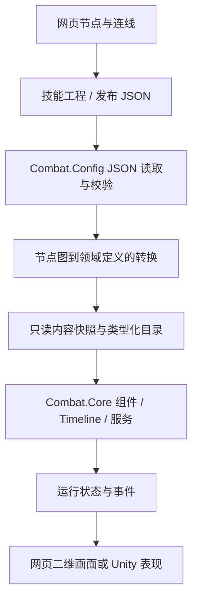
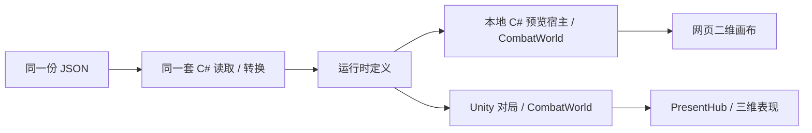

# 网页节点与 HaloCombat 运行时的映射

日期：2026-11-14。状态：部分实现；下方原始设计表仍保留历史范围，当前落地状态以下节为准。

## 当前已实现的链路

`SkillProjectJson` 严格读取工程，`CombatContentCompiler` 将目标、施放、投射物、伤害和 Cue 图转换为 `CombatContentSnapshot`。`SkillCastComp` 守卫状态/冷却/能量，`SkillDirectorComp/TimelinePlayer` 播放 Payload，通过正式 World.Deliver 与 ProjectileService 运行。引导使用有重复间隔的 Payload，分段扣费/每秒消耗只影响当次播放，详见 ADR-0004。

蓄力由 `SkillCastCompiler` 将施放参数转换为 `ChargeDefinition`，`TimelinePlayer` 保存本次保持时间，释放时锁定瞄准与倍率，再推进释放后的 Timeline。已有 `EffectContext.Power` 通过生成/命中 Intent 和 ProjectileComp 传递到伤害，不修改共享效果定义。初始能量通过 PreviewDocument 独立映射到 EnergyComp，详见 ADR-0005。

目标/区域传递由 `SkillEffectCompiler` 转换为 `TargetEffects`、`CircleEffects` 或 `AoeDefinition + SpawnAoeEffect`。伤害节点 scope=area 包装同一个 CircleEffects，命中事件点不会被施法者位置替代；next 在本范围结算后只执行一次。持续区域的 Source、生命周期、Power、独立查询快照和到期区间详见 ADR-0006。编译缓存仅在本次转换内复用节点定义，重复边仍重复执行，不因为引用同一节点被去重。

近战/冲刺从根施放生成绑定 Payload 索引的 Clip 原型；每个成功触发拥有独立 ClipRuntime/handler/完整实体命中集合。闪现生成绑定施放的延迟 Payload，由同一个 TimelinePlayer 保存实例上下文并在打断时清理。几何经 SpatialGeometry 查询、ApplyEffectsIntent/World.Deliver 结算，位移经 Locomotion.RequestSkillDelta/RequestTeleport。网页/Unity 只消费 EvSpatialVolume 对应快照。详见 ADR-0007。

`CombatWorld.Collision` 从当前内容场景接收矩形定义，连续圆形/线段检测复用于最终位移、冲刺请求、闪现净空、射线和弹体。射线编译为 RayStrikeEffect，命中按接触距离和完整身份排序；投射物以实际累计路径/寿命结束，ApplyEffectsIntent 之后才清算专属的终结队列。网页障碍和射线、Unity Cube/LineRenderer 均从同一只读快照绘制，Collider 不参与规则。详见 ADR-0008。

召唤节点编译为 SummonDefinition + SpawnSummonEffect，蓝图在 Combat.Config 内校验并转换到 SummonBlueprintCatalog；工厂按蓝图组合现有组件，ActCastSkill 经统一守卫输入，SummonComp 管理寿命/归属/级联清理。依赖索引建立 技能→蓝图→攻击技能 闭包，发布裁剪和两槽组合都使用此索引；无递归与隐藏代码回退。网页只编辑和显示定义/快照，原样传给 Unity，详见 ADR-0009。

共享 Buff 的 `BuffDocument` 包含作者属性与独立 Nodes/Edges；`BuffCompiler` 将其转换为 `DurationSpec` 和生命周期效果数组，技能中的 buff/dispel/heal 节点转换为 `ApplyDurationEffect`、`DispelEffect`、`HealEffect`。`BuffComp` 独占实例年龄、来源完整身份、攻击/倍率快照、叠层和生命周期；`AttributeSet` 与可释放 `TagLease` 管理实例资格，移除先释放状态再回调。图布局不进入 Core，前端只消费 Buff/属性/Tag 快照。详见 ADR-0010 与 Buff 验收。

`EffectGraphIndex` 同时服务技能效果图与 Buff 生命周期图；`ContentDependencies` 以具名类型身份建立技能/Buff/蓝图攻击依赖，拒绝循环和超过8层的派生。发布闭包与两槽同版本检查沿用同一索引，不新增第二套 Buff 执行器。

多重参数转换为 `SpawnProjectileEffect` 的一次均匀发射，连锁参数转换为 `ProjectileChainDefinition`；`ProjectileComp` 持有独立每段预算/祖先命中记录/累计年龄与路径，`ProjectileService` 在真实命中效果结算后转向。分裂节点转换为 `SplitProjectileEffect`，只有投射物hit边界形成的 `ProjectileHitContext` 才能派生子弹；沿用原定义、伤害管线和意图队列，下一逻辑步出弹。SkillOrigin在发射时捕获技能/CastId，分支发射额度与每弹独立命中集合分开。详见ADR-0011。

运动参数转换为`ProjectileMotionDefinition`与可选`ProjectileBounceDefinition`；`ProjectileKinematics`负责分段速度积分/逆时间、竖直重力与落地根，`ProjectileService`在返回/捕获/碰撞/射程边界调度真实事件。定义不持有当前速度或返程状态，分裂通过专用Seed继承命中时高度/竖直速度。网页与Unity只读取Y/Speed/VerticalSpeed/Returning/剩余次数，俯视图投影不改变X/Z战斗判定。详见ADR-0012。

`DamageEffect`生成不可变`DamageResult`，由结果决定实际HP/护盾、事件与扣血后条件；`after-damage`节点转换为`AfterDamageEffect`，`impact`转换为已有受击/击退/无敌组件及通用击飞/拉动/护盾效果。`skill-events`根转换为`SkillEventCatalog`中固定的有序效果包，World按SkillOrigin投递；追加效果通过不可变Origin抑制标志贯穿延迟实例，不再次驱动事件根。JSON/作者图不进入运行调度。详见ADR-0013。

网页宿主和 Unity SkillLab 共用 `Combat.Config/Json/SkillSimulation`、Actor 工厂和只读快照；不是两份互相拟合的战斗算法。`SkillPublicationJson` 明确选中技能和修订号，`PublishedSkillSession` 校验并组合两槽后完整替换会话，`SkillLabRunner` 负责磁盘/F5/F6/F7/输入，`SkillLabVisuals` 仅读取快照。详见 ADR-0003 和实施进度。

正式JSON现已扩展显式Timeline（四类原Clip/离散Payload）、Combo、Actor、Motor和Cue，并替换V1–V4/TrainingCamp的配置读取；旧SO作者/资产/生成器已经删除。`RuntimeProjectLoader → RuntimeContentSnapshot → RuntimeActorFactory`执行实际正式内容，CLI与网页同源，SkillCastComp统一守卫，失败不消费输入。`TimelineDefinition/ComboTableDefinition`是纯C#领域类型。更多传递/结算/弹体节点、Arena恢复及旧分支未含的缺弹/木桶能力仍按完整清单推进，见ADR-0015。下文较早快照的Arena/BuffArena路径不代表当前分支已有这些类型。

> 基线提示：本文件的源码证据来自本次会话较早的工作区快照。后续审查中工作区已切换至 HEAD `1fa8b14`，其中部分 BuffArena 类型、冷却和运动策略不再存在。节点映射的产品目标保留；当前实现状态与优化优先级请结合 [技能模块化优化建议](技能模块化优化建议.md) 重新核对，不把下文旧路径当作当前已实现能力。

已决定的产品方向见 ADR-0001：独立网页、JSON 唯一配置源、移除 SO 路径；装备、计算公式、地图、冒险四个独立页面不实现。

## 映射的基本方式

节点是作者表达，JSON 是内容契约，Core 定义和组件负责执行。加载时把有限、明确的节点类型转换成已有领域定义及必要的新增定义；运行中继续由组件、Timeline 和服务推进。



一个节点不对应一个 Actor、Comp 或 MonoBehaviour。比如“生成弹体”与“命中伤害”两个节点，分别生成时间点的 SpawnProjectileEffect，以及 ProjectileDefinition.OnHit 的 DamageEffect；子弹实际出生后才有自己的 Actor/ProjectileComp。

图中节点位置、缩放、折叠和分组只属于编辑元数据。配置语义通过稳定节点 ID、模块类型、字段和端口连接表示。图是唯一作者语义源；如果导出额外的运行 JSON，它只能是自动生成的派生产物，不能与图各自手工维护业务参数。

## 三个明确的边界

1. 网页层维护合法编辑、参数控件和业务图，提交或导出 JSON；不传 Unity 对象，也不在 JSON 中保存 C# 类名、反射构造指令或可执行脚本。
2. Combat.Config 读取协议 DTO，验证类型、字段、身份、引用、端口、顺序与递归，再按明确转换逻辑构造 Core 定义。沿用现有 Config 边界，随着 SO 删除移除其 Unity 依赖；不为这次替换再拆一串程序集。
3. Combat.Core 只接收构建好的定义、输入与初始场景数据，运行态属于 Actor/Comp/服务。核心不读取 DOM、节点坐标或作者 JSON，也不逐帧解释通用节点图。

可将读取校验和领域转换分别命名为 CombatJsonLoader、CombatContentCompiler，输出 CombatContentSnapshot；这些是拟新增名称，当前代码还不存在。

## 节点映射表

| 网页节点/连接 | 生成的领域内容 | 实际执行者 | 当前边界 |
| --- | --- | --- | --- |
| 目标选择 | TargetDefinition：选择方式、范围、锁定时机 | 在施放/事件边界的目标解析；World.Query、World.Random | 圆/扇查询已有，通用玩家目标配置与传递尚需补 |
| 瞬发、冷却、延迟 | 技能冷却/资源规则；延迟处的 TimelinePayload | 统一施放入口、SkillDirectorComp、TimelinePlayer | Core 有冷却，Arena 当前绕过该目录入口 |
| 有限连发 | 按顺序生成多个定时 Payload，必要时逐段包含资源结算 | TimelinePlayer 与专职资源组件 | 时点触发可复用，逐段扣费/失败语义需新增 |
| 引导、蓄力 | CastDefinition 和可结束的持续/释放时序 | 持有输入的施放协调、Timeline 持续过程、资源组件 | 新能力；当前有限 Timeline 与 Fire1Held 不等同于它 |
| 投射物传递 | TimelinePayload + SpawnProjectileEffect + ProjectileDefinition | TimelinePlayer → Intent → ProjectileService → ProjectileComp | 主链可复用，发射原点/方向选择需扩展 |
| 多重发射、散射 | SpawnProjectileEffect数量/夹角、独立生成意图 | ProjectileService / ProjectileEmission | ADR-0011已实现，同时多发不重复施法费用 |
| 穿透、连锁 | ProjectileChainDefinition及每弹独立命中/段预算 | ProjectileComp / ProjectileService | ADR-0011已实现有限/无限穿透和最近/随机连锁 |
| 命中分裂 | SplitProjectileEffect + ProjectileHitContext + ProjectileSeed | 投射物命中边界与生成意图 | ADR-0011已实现，从碰撞点派生，支持代数/倍率/剩余或固定射程 |
| 当前目标伤害 | DamageEffect 的明确字段 | World.Deliver → EffectPipeline → DamageEffect | 可复用；新伤害类型要有真实规则 |
| 命中点范围结算 | 范围查询与逐目标效果投递 | World.Query → World.Deliver | 圆查询与伤害可复用，需提供具名范围结算 |
| 持续区域 | AoeDefinition 的周期/占用/事件包 | AoeService / AoeComp | 可复用并补协议映射 |
| Buff/Debuff | DurationSpec + ApplyDurationEffect / DispelEffect | BuffComp、AttributeSet、TagComp | 可复用并补协议映射 |
| 近战判定 | Hitbox Clip + 命中形状/时序 + 命中效果包 | Clip handler、HitDetectService、World.Query | 圆形 Hitbox 已有；OverlapFan 已有，形状定义和刺击宽度仍需接入 |
| 冲刺、无敌、取消窗 | Move / IFrame / CancelTag Clip | 对应 handler、LocomotionComp、TagComp | 可复用，保留 Open/Tick/Close |
| 闪现打击 | 目标解析、落点校验、移动请求、到达/命中投递 | 移动与结算能力 | 有 TeleportEffect/RequestTeleport；不能直接当成完整闪现攻击 |
| 射线、召唤分身 | 具名射线定义 / SummonDefinition / 生成效果 | 查询、召唤实体与生命周期 | 射线需补；召唤 Core 有基础，Arena 目录尚未接通 |
| Cue/表现事件 | CueId/resourceKey 和播放效果 | 核心发 EvCue，表现消费 | 可复用事件，SO 资源映射需替换 |
| 技能事件端口 | 对应触发点的有序效果包 | 既有事件/生命周期边界，仍进入效果管线 | Projectile/AoE/Buff 多数事件包已有；全技能暴击/击杀/完成路由需补 |
| 连线“继续” | 显式排序的效果数组 | EffectPipeline | 不按节点坐标排序，不增加通用短路语义 |
| 连招配置 | ComboEntry 的来源、输入、条件、优先级和目标 | ComboComp / 输入缓冲 / 施放入口 | 继续使用边表，不建立新的图状态机 |

当前已使用TimelineDefinition、ComboTableDefinition两个纯C#领域类型；原SO作者链路已删除。下文保留较早方案作为历史上下文，最新实现见ADR-0015和实施进度。

## 一次普通射击怎样落地

作者图：指定位置 → 瞬发（冷却 0.7s、延迟 0.1s）→ 投射物（12m/s、24m）→ OnHit → 伤害（基础 80）。数字仅为说明映射，不表示已经形成正式协议。

转换输出：

```text
SkillDefinition
  Target: 指定位置/方向的目标规则
  Cast: 瞬发；Cooldown = 0.7；资源规则
  Timeline: 对应 TimelineDefinition

TimelineDefinition
  Payload(Time = 0.1)
    Effects[0] = SpawnProjectileEffect(对应弹体身份)

ProjectileDefinition
  Speed = 12
  Range = 24（新增明确距离语义，不能直接假定现有 Lifetime 字段就是射程）
  OnHit[0] = DamageEffect(Flat = 80, Coeff = 0)
```

实际执行路径：输入先到 InputBuffer / ComboComp，再进入统一施放入口检查状态、目标、资源与冷却，成功后由 SkillDirectorComp 播轴；Payload 触发 SpawnProjectileEffect，ProjectileService 创建和推进子弹；命中进入 ApplyEffectsIntent，再经 World.Deliver 和 EffectPipeline 调用 DamageEffect。

当前 DamageEffect 同时支持攻击系数与平值，不能把网页“基础伤害 80”直接写成 Coeff=80；“计入加成”也不能映射成 UseSnapshotAtk，后者只决定取快照攻击还是实时攻击。物理/元素区分、百分比的数值范围和加成策略都要在协议里明确。

瞬发的冷却不等于 Timeline 持续时间。前摇、攻击区间、取消窗与恢复期属于时间轴，不从 Cooldown 自动推导。有限连发展开时保证总时长覆盖最后一次触发，处理同一步到期和小间隔多发的实际顺序。

## 哪些地方需要实改当前代码

### 统一技能入口与配置目录

当前 Core 的 SkillDefinition 有 Cooldown，SkillDirectorComp.Play(skill) 会检查并写入冷却；Arena 的 BuffArenaSkill 没有此字段，而且 BuffArenaPlayerComp 调用 Play(skill, timeline)，工厂没有安装通用 SkillCatalog。

建议收敛为一份 SkillDefinition 与一条施放入口，玩家、AI、F6/F7 和预览都通过它走守卫；迁入弹药/回退等必要信息后删除旧的重复技能定义和绕过新规则的内部路径，不保留两套长期兼容目录。键位仍属于输入映射，ComboEntry 仍是输入到技能的配置入口，不在技能定义中重复维护同一按键事实。

施放协调可以采用一个专职 SkillCastComp：接收按下/保持/松开、解析目标、协调资源与开始/结束请求。它不计算伤害、不持有全场 Actor，也不复制时间轴推进。冷却计时仍保留一个权威；能量由专职属性/资源组件修改。

引导/蓄力的持续与释放需要扩展当前有限轴表达：时序仍由 Timeline 驱动，进入/持续/释放/打断各有清理契约。不能用 float.MaxValue 冒充完整引导，也不能每次循环 Play 新技能导致 CastId、输入消费、OnOwnerCast 和 ComboConfirm 被重复重置。具体持续轴结构在实现前单独细化并验证。

### 目标、命中点和方向贯穿

当前 TimelinePlayer.FirePayloads 只从 AI 黑板读取目标；玩家普通 Payload 没有选中目标。需要在正式施放边界解析玩家/预览目标，将施法实例拥有的目标 EntityId、点和方向提供给后续 Payload，不用长期 Actor 强引用。

当前 SpawnProjectileEffect 总从 ctx.Source 的位置和朝向生成。虽然 SpawnProjectileIntent 已支持 Origin/Yaw，现有效果并不自动使用命中点。分裂与多重发射需要具名的发射请求/投射物处理路径。

分裂还依赖父弹代数、入射方向、剩余射程和伤害倍率。它们属于专用投射物事件参数/ProjectileComp 状态，由投射物边界形成派生请求；不能为它把 EffectContext 扩成装有全部系统状态的容器，也不能把每颗子弹状态写回共享定义。

### 判定形状和射程

World.Query 已有 OverlapCircle 和 OverlapFan。近战扇形可复用现有查询，但现有 HitboxComp 只有半径/偏移，需补形状定义及 handler/service 接入；刺击宽度和射线也需要独立准确几何规则。

现有弹体主要按 Lifetime 收尾，视频参数是飞行距离。对直线匀速弹可以明确转换，但加速、回旋、连锁和分裂不能普遍用 range/speed 代替真实路径距离。应补足距离累计、终结原因和各终结事件的恰好一次投递。

### 效果包与事件

节点“继续”编译成同一包内的有序效果。普通 IEffect 无统一失败返回值；一个效果无有效目标返回，不表示后续效果自动停止。条件分支用已有 AfterDamageEffect 等具名规则表达，不能靠可视化连线改变语义。

技能暴击/击杀/完成等端口需要在已有事件或生命周期点接入，保留 Skill/CastId 和准确目标/位置，以现有事件/意图边界分发后续效果，不引入第二套战斗消息系统。生成、命中和结束不能都当作同一个触发点；自然完成与被打断必须区分。

## JSON 读取和节点转换的最小结构

建议按三步工作，不建立通用脚本 VM：

1. 协议层：读取 formatVersion、skills、typed nodes、edges 和引用定义；显式模块白名单和带路径的错误。
2. 转换层：校验端口，解析数据引用，按显式执行边构建效果包与事件包，产生目标/施放规则、Timeline、Projectile、AoE、Buff 和 Combo 定义。
3. 安装层：将完整快照一次装入 Catalog/World，启动前检查所有身份、引用、资源、时间区间和递归。运行中不再按节点字符串查询下一条边。

节点 kind 与字段到运行定义的转换是固定明确的代码分派，如 damage→DamageEffect、projectile→ProjectileDefinition。新增节点类型必须同时提供编辑字段、JSON 校验、转换、Core 执行和测试；只增加前端选项不能作为能力交付。

JSON 协议类型与运行时模型不同：例如 JSON 写伤害模块和数值，转换后才是 IEffect 实例；不能把任意 JSON 直接反序列化成 IEffect。编译只做内容建模和验证，不选随机目标、不消耗资源、不写战斗世界。

## 网页预览与游戏怎样共用

建议网页只负责编辑与二维渲染，预览交给一个独立本地 C# 宿主。宿主和 Unity 都使用同一套 Combat.Config JSON 读取/转换与 Combat.Core；网页传运行命令，接收只读实体快照和事件。这是本次建议，预览宿主技术选择尚未被记录为用户已决定的实现。



这样不需要用 TypeScript 再写一遍伤害、Buff、连锁和技能时钟。现有 Combat.Unity.Game 的会话不能被当作已可直接给独立 .NET 宿主引用的程序集：它与 Unity 表现同属 Unity 程序集。宿主应装配纯 Core 世界与相同定义；共同的角色初始化、技能输入与试验布置逻辑按实际职责复用，不能各端各写一套默认数值来冒充一致。

仍需对照配置、初始属性/布置、输入步骤、随机决策和事件序列；仅复用 Core 不保证两边的装配数据和输入已经相同。Unity Prefab/Animator/音效表现也不能由二维运行结果代替验证。

## 节点与运行日志的反向定位

每个作者节点有稳定 nodeId。转换时生成独立来源表：运行定义身份、Payload/事件效果位置 → 作者 nodeId；一个作者节点可以展开成多个执行点，多个使用位置也可引用同一只读效果。

诊断事件记录 skillId、CastId、nodeId、实体身份、调度步和结果。来源表属于诊断元数据，不把节点坐标或通用图访问器塞进 Core。现有 EvDamage 有 Skill/CastId，但没有 nodeId；因此需要明确诊断观察点，不能声称现在已经能精确高亮每个节点。

布局重排不能改变 nodeId，导出重新加载后仍可定位。重复引用和数组顺序是执行语义；来源表不能为了图去重而把两次效果执行合并。

## 最先验证的映射样例

先让目标选择 → 瞬发/延迟 → 投射物 → 命中伤害这条链从网页 JSON 进入实际 Core，验证目标/方向、冷却/资源、定时出弹、命中点、伤害事件与节点定位。随后验证命中爆炸、有限连发、扇形与 Buff，再依次接入引导/蓄力、分裂/连锁和新增传递方式。

该顺序是实现增量，不缩减完整功能清单。每一步完成编辑、协议、转换、执行和回归闭环后再进入下一类节点。

本轮只更新范围与设计文档；没有实现 JSON Loader、节点编译器、新组件或预览宿主，没有执行 .NET/Unity 构建或测试。
